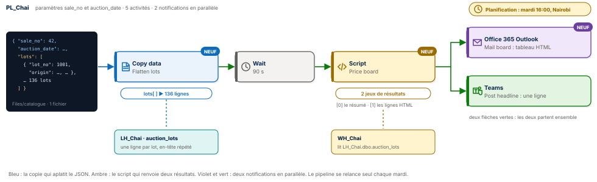
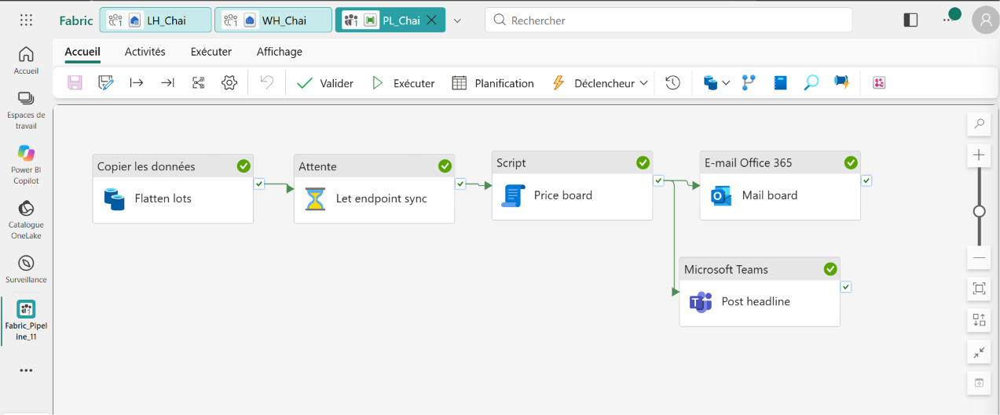
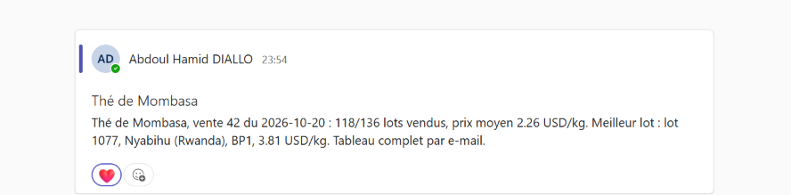
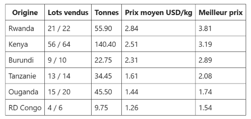
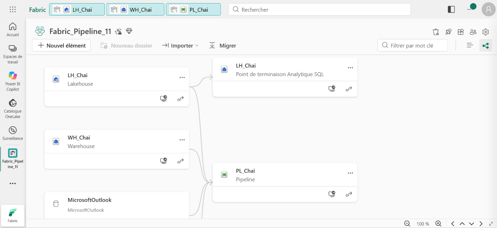

# 🍵 Fabric Pipeline Express 11 : un JSON aplati, un tableau HTML, une planification




Un pipeline Microsoft Fabric Data Factory qui traite le lendemain d'une vente aux enchères de thé à Mombasa, au Kenya, où se vendent les récoltes de six pays d'Afrique de l'Est. Le catalogue arrive en un seul fichier JSON imbriqué. Une copie l'aplatit en une ligne par lot, un Script calcule le marché du jour en deux résultats, puis le pipeline envoie en même temps un e-mail avec un tableau HTML par pays d'origine et un titre dans Microsoft Teams. Une planification le relance seul chaque mardi.

**Guide PDF de 7 pages inclus** : [`Pipeline_Fabric_Guide_11_public.pdf`](Pipeline_Fabric_Guide_11_public.pdf). Chaque activité, chaque réglage, chaque expression, et les chiffres à retrouver à l'unité près. Les valeurs à copier sont dans [`data/expressions.txt`](data/expressions.txt) et les requêtes commentées dans [`sql/`](sql).

## 📸 Aperçu

`PL_Chai` après une exécution réussie : la copie qui aplatit le JSON, l'attente, le Script, puis deux notifications qui partent ensemble.



Le titre publié dans Microsoft Teams, construit à partir du premier résultat du Script.



Le tableau reçu dans Outlook, écrit entièrement par le second résultat du Script, du meilleur prix moyen au plus bas.



Le lignage de l'espace de travail : le lakehouse et l'entrepôt alimentent le pipeline, qui s'appuie aussi sur les connexions Outlook et Teams.



## 🎯 Résultats clés

| Indicateur | Valeur |
|---|---|
| Activités | 5 (Copy data, Wait, Script, Office 365 Outlook, Microsoft Teams) et une planification |
| Nouveautés | JSON imbriqué aplati par la copie, nom de fichier construit par expression, Script à deux résultats, tableau HTML écrit par le SQL et envoyé tel quel, deux notifications en parallèle, planification hebdomadaire |
| Lots au catalogue | 136, venus de 6 pays |
| Lots vendus | 118 (18 retirés, invendus) |
| Thé vendu | 308,75 tonnes pour 697 066,5 USD |
| Prix moyen pondéré | 2,26 USD/kg |
| Meilleur lot | lot 1077, Nyabihu (Rwanda), BP1, 3,81 USD/kg |
| Écart de prix moyen | 2,84 USD/kg au Rwanda contre 1,26 en RD Congo |

## 💼 Impact métier

Après une vente, acheteurs, courtiers et producteurs veulent la même chose : savoir combien s'est vendu, à quel prix, et qui a obtenu les meilleurs cours. Le catalogue arrive pourtant dans un format pensé pour les machines, un JSON imbriqué illisible tel quel. Ce pipeline le transforme en rapport prêt à lire : un tableau par pays dans la boîte mail, un titre dans Teams, chaque mardi à 16 h, heure de Nairobi, sans intervention. Il montre aussi ce que la moyenne simple cacherait : le Kenya fournit près de la moitié du volume, mais c'est le Rwanda qui obtient le meilleur prix moyen.

## 📝 Résumé

`PL_Chai` reçoit deux paramètres, `sale_no` et `auction_date`, qui construisent le nom du fichier : `mombasa_sale42_2026-10-20.json`. La copie `Flatten lots` lit ce JSON dans `Files/catalogue` du lakehouse `LH_Chai`. À l'import du schéma, Fabric reconnaît le tableau `lots` et produit une ligne par lot, en recopiant l'en-tête de la vente sur chacune ; les colonnes `lots.xxx` sont simplement renommées. Après 90 secondes de synchronisation, le Script `Price board`, exécuté sur l'entrepôt `WH_Chai`, lit `LH_Chai.dbo.auction_lots` et renvoie deux résultats : le marché du jour, puis les lignes du tableau HTML par origine. `Mail board` et `Post headline` partent ensemble. La planification relance le tout chaque mardi.

## 🔁 Pipeline

| Activité | Type | Rôle |
|---|---|---|
| `Flatten lots` | Copy data | `@concat('mombasa_sale', sale_no, '_', auction_date, '.json')` vers `auction_lots`, une ligne par lot, action Remplacer |
| `Let endpoint sync` | Wait | 90 secondes pour que le point de terminaison SQL voie la nouvelle table |
| `Price board` | Script | Deux requêtes : `resultSets[0]` le marché du jour, `resultSets[1]` le tableau HTML complet, trié par prix moyen |
| `Mail board` | Office 365 Outlook | Corps réduit à une ligne : `@{...resultSets[1].rows[0].html_table}` |
| `Post headline` | Microsoft Teams | Le titre de la vente, en parallèle de l'e-mail |
| Planification | Déclencheur planifié | Chaque mardi à 16:00, fuseau (UTC+03:00) Nairobi |

## 🧠 Les quatre idées du projet

**Aplatir sans code.** Un fichier, un objet, mais 136 lignes en sortie : la copie déplie le tableau `lots` et répète l'en-tête de la vente sur chaque ligne. C'est un `explode` Spark, obtenu dans l'onglet Mappage.

**Un Script, deux réponses.** Deux `SELECT` dans le même Script donnent deux résultats, lus par `resultSets[0]` et `resultSets[1]`. Un seul aller-retour vers l'entrepôt pour le résumé et le tableau.

**Le SQL écrit le HTML, l'e-mail le transporte.** `STRING_AGG` fabrique les lignes `<tr>` dans l'ordre des prix, un `CONCAT` ajoute `<table>` et l'en-tête. L'éditeur du corps protégerait des balises tapées à la main ; le HTML renvoyé par une activité, lui, est interprété. Le corps ne contient donc qu'une référence à `html_table`, et le tableau s'affiche.

**Le temps comme déclencheur.** La planification lance le pipeline avec les valeurs par défaut de ses paramètres. Pour la vente 43, on change `sale_no` et `auction_date`, et le nom du fichier suit.

## 🚦 Le pipeline en une image

| Étape | Dans une salle des ventes | Dans Fabric |
|---|---|---|
| 1 | Le commis déplie le catalogue, une fiche par lot | Copy data et mappage du tableau `lots` |
| 2 | Le commissaire fait les comptes de la vente | Script à deux résultats sur `WH_Chai` |
| 3 | Le courrier part avec le rapport complet | Office 365 Outlook, tableau HTML |
| 4 | Le crieur annonce le titre du jour | Microsoft Teams, au même moment |
| 5 | L'horloge rouvre la salle chaque mardi | Planification hebdomadaire |

## 🧬 Traçabilité

```
LH_Chai / Files / catalogue / mombasa_sale42_2026-10-20.json
   { "sale_no": 42, "auction_date": "2026-10-20", ..., "lots": [ 136 objets ] }
                                         │  Copy data Flatten lots (nom de fichier par expression)
                                         ▼
LH_Chai.dbo.auction_lots   136 lignes : en-tête répété + lot_no, garden, origin, grade, packages, kg, price_usd_kg
                                         │  Wait 90 s
                                         ▼
Script Price board sur WH_Chai
   ├─ resultSets[0]  lots 136 · sold 118 · tonnes 308.75 · avg 2.26 USD/kg · best lot 1077 Nyabihu (Rwanda)
   └─ resultSets[1]  html_table : <table>... en-tête et six lignes triées par prix moyen
                                         ▼
   ├─▶ Office 365 Outlook Mail board   moyenne dans l'objet, tableau HTML par origine dans le corps
   └─▶ Microsoft Teams Post headline   « Thé de Mombasa, vente 42 du 2026-10-20 : 118/136 lots vendus, ... »
Planification : chaque mardi, 16:00, (UTC+03:00) Nairobi
```

## 🏗️ Architecture

| Objet Fabric | Type | Rôle |
|---|---|---|
| `LH_Chai` | Lakehouse | Reçoit le catalogue dans `Files/catalogue`, porte la table `auction_lots` |
| `WH_Chai` | Entrepôt | Exécute le Script et lit le lakehouse par son nom à trois parties |
| `PL_Chai` | Pipeline | Orchestre la copie, l'attente, le calcul, les deux notifications et la planification |

La seconde requête du Script, qui écrit tout le tableau HTML :

```sql
WITH l AS (SELECT origin, CAST(kg AS int) AS kg, CAST(price_usd_kg AS float) AS p FROM LH_Chai.dbo.auction_lots),
t AS (SELECT origin, COUNT(*) AS lots, COUNT(p) AS sold,
             CAST(SUM(CASE WHEN p IS NOT NULL THEN kg END) / 1000.0 AS decimal(9,2)) AS tonnes,
             CAST(SUM(kg * p) / SUM(CASE WHEN p IS NOT NULL THEN kg END) AS decimal(5,2)) AS avg_usd_kg,
             MAX(p) AS top_usd_kg
      FROM l GROUP BY origin)
SELECT CONCAT('<table border="1" cellpadding="6" style="border-collapse:collapse">',
              '<tr><th>Origine</th><th>Lots vendus</th><th>Tonnes</th><th>Prix moyen USD/kg</th><th>Meilleur prix</th></tr>',
              STRING_AGG(CONCAT('<tr><td>', origin, '</td><td>', sold, ' / ', lots, '</td><td>', tonnes,
                                '</td><td>', avg_usd_kg, '</td><td>', top_usd_kg, '</td></tr>'), '')
              WITHIN GROUP (ORDER BY avg_usd_kg DESC),
              '</table>') AS html_table
FROM t;
```

Le prix moyen est pondéré par le poids : la valeur totale divisée par les kilos vendus. Un lot retiré a un prix `NULL` : il compte dans les lots offerts, pas dans le poids ni la valeur.

## 📊 Résultat final

Le tableau reçu par e-mail, du meilleur prix moyen au plus bas :

| Origine | Lots vendus | Tonnes | Prix moyen USD/kg | Meilleur prix |
|---|---|---|---|---|
| **Rwanda** | 21 / 22 | 55,90 | **2,84** | **3,81** |
| Kenya | 56 / 64 | 140,40 | 2,51 | 3,19 |
| Burundi | 9 / 10 | 22,75 | 2,31 | 2,89 |
| Tanzanie | 13 / 14 | 34,45 | 1,61 | 2,08 |
| Ouganda | 15 / 20 | 45,50 | 1,44 | 1,74 |
| RD Congo | 4 / 6 | 9,75 | 1,26 | 1,54 |

## 📦 Jeu de données

```
data/
├── catalogue/
│   └── mombasa_sale42_2026-10-20.json   en-tête de la vente et 136 lots
└── expressions.txt                      toutes les valeurs du guide, prêtes à copier
```

Chaque lot porte `lot_no`, `garden` (le jardin de thé), `origin`, `grade` (BP1, PF1, PD, D1, FNGS, DUST1), `packages` (colis de 65 kg), `kg` et `price_usd_kg`, à `null` quand le lot n'a pas trouvé preneur. Données fictives, conçues pour l'exercice et reproductibles avec [`tools/generate_dataset.py`](tools/generate_dataset.py) ; [`tools/expected_results.py`](tools/expected_results.py) recalcule le marché et le tableau attendus.

## 🚀 Reproduire l'exercice

1. Créer un lakehouse `LH_Chai`, un dossier `Files/catalogue`, y déposer le JSON. Créer un entrepôt `WH_Chai`.
2. Créer `PL_Chai` avec les paramètres `sale_no` = `42` et `auction_date` = `2026-10-20`.
3. Copy data `Flatten lots` : nom de fichier par expression, format JSON, **Importer des schémas**, renommer les sept destinations `lots.xxx` sans le préfixe. Exécuter : 136 lignes.
4. Wait de 90 s, puis Script `Price board` sur `WH_Chai` avec les deux requêtes de [`sql/01_market_summary_and_html_table.sql`](sql/01_market_summary_and_html_table.sql).
5. Outlook (corps réduit à la ligne `html_table`) et Teams, tous deux reliés au Script. Exécuter, puis activer la planification du mardi.

## 📂 Structure du dépôt

```
fabric-pipeline-express-11/
├── README.md
├── Pipeline_Fabric_Guide_11_public.pdf      le guide de 7 pages
├── data/                                    le catalogue JSON et les expressions
├── sql/
│   ├── 01_market_summary_and_html_table.sql  les deux requêtes du Script
│   └── 02_controle.sql                      lots offerts et vendus par origine
├── tools/
│   ├── generate_dataset.py                  régénère le catalogue
│   └── expected_results.py                  recalcule le marché attendu
└── images/
    ├── pipeline_diagram.svg                 le schéma du pipeline
    ├── pipeline_run.png                     PL_Chai après une exécution réussie
    ├── teams_message.png                    le titre dans Microsoft Teams
    ├── email_board.png                      le tableau reçu dans Outlook
    └── lineage.png                          le lignage de l'espace de travail
```

## 🧰 Stack technique

Microsoft Fabric Data Factory · Copy data JSON et mappage · Expressions `@concat` · Wait · Script à plusieurs résultats · Warehouse et T-SQL · `STRING_AGG` · Lakehouse et Delta · Office 365 Outlook · Microsoft Teams · Planification

## ✅ Conclusion

Un fichier conçu pour les machines devient un rapport conçu pour les gens. La copie déplie le JSON, le Script calcule le marché et écrit le tableau, l'e-mail le transporte tel quel, et la planification fait revenir le tout chaque semaine. Cinq activités, aucun code Spark, et le marché du thé d'Afrique de l'Est dans la boîte mail chaque mardi.

## 💭 Dernier mot

La donnée la plus utile n'est pas celle qui est stockée. C'est celle qui arrive, lisible, au bon endroit et au bon moment.

---

Abdoul Hamid Diallo · Microsoft Data & AI Engineer · Microsoft Certified DP-600, DP-700, PL-300, AI-102, DP-100, AI-900, DP-900 · [LinkedIn](https://www.linkedin.com/in/abdoul-hamid-diallo-fabric-data-engineer/)
